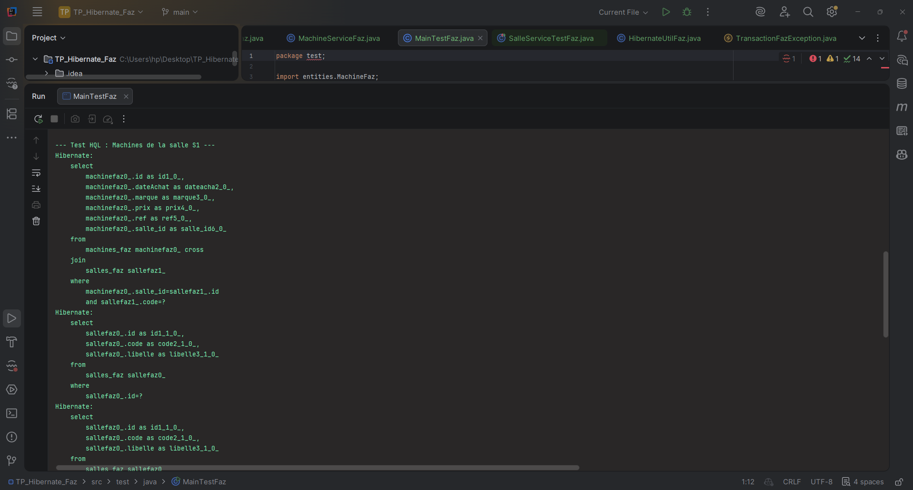
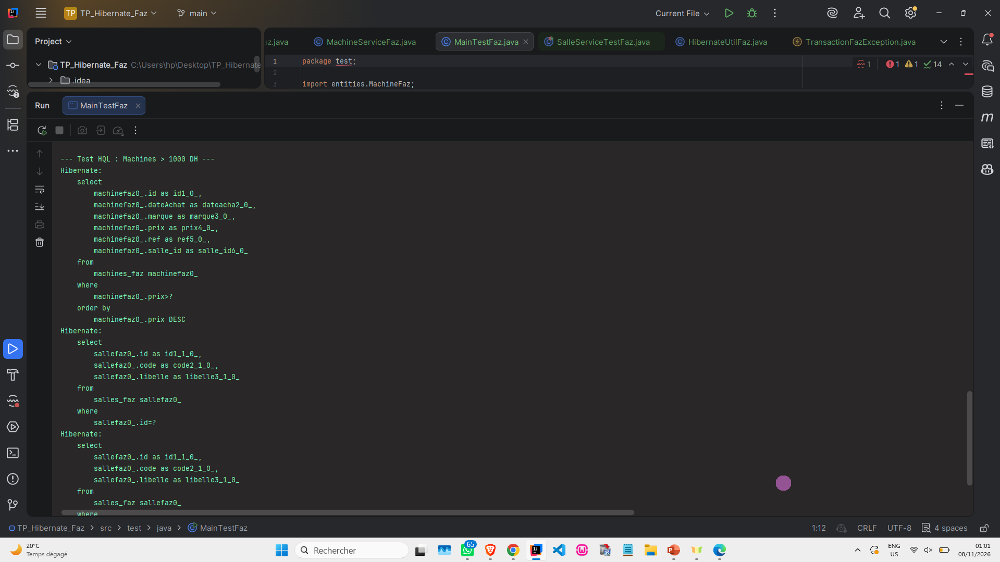
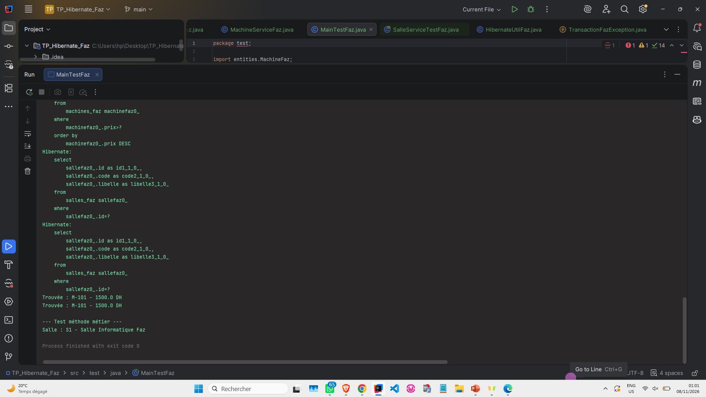
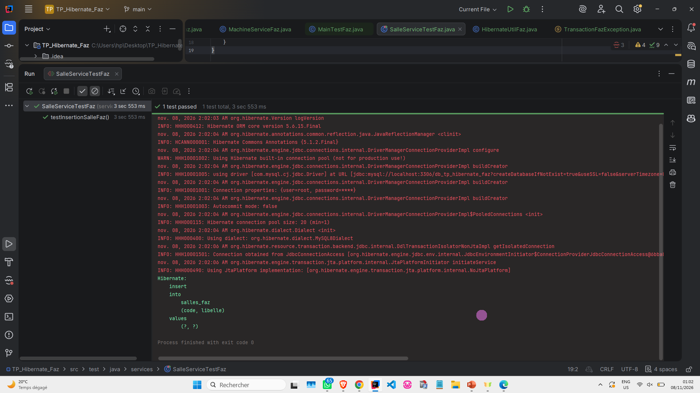

# TP Hibernate - Gestion des Salles et Machines (Version Faz)

## 📌 Description du Projet
Ce projet est une application Java illustrant l'utilisation de **Hibernate** comme ORM (Object-Relational Mapping) pour interagir avec une base de données **MySQL**. Il met en œuvre une architecture en couches (Entités, DAO, Services) et utilise **JUnit** pour les tests unitaires.

Pour garantir l'unicité de ce travail, toutes les entités, interfaces et méthodes portent le suffixe **`Faz`** et les noms de méthodes ont été personnalisés.

---

## 🛠️ Technologies Utilisées
*   **Langage :** Java 23
*   **ORM :** Hibernate 5.6.15.Final
*   **Base de données :** MySQL 8.0
*   **Gestionnaire de dépendances :** Maven
*   **Tests :** JUnit 5

---

## 📸 Captures d'écran et Explications

### 1. Insertion des données (MainTestFaz)

*Commentaire :* Cette capture montre l'exécution de la classe `MainTestFaz`. On y voit la création de la salle et des machines, ainsi que les requêtes SQL générées par Hibernate (`insert into...`). Les messages "Salle insérée avec ID : 2" confirment le bon fonctionnement de la persistance.

### 2. Requêtes HQL Avancées

*Commentaire :* Cette capture illustre l'utilisation du langage HQL (Hibernate Query Language). On y voit l'exécution des méthodes personnalisées `trouverMachinesParCodeSalleFaz` et `trouverMachinesPlusCheresFaz`. Le filtre par prix (`> 1000 DH`) fonctionne parfaitement et affiche uniquement la machine Dell.

### 3. Validation et Fin d'exécution

*Commentaire :* Cette capture montre la fin de l'exécution de l'application avec le message `Process finished with exit code 0`. Cela prouve que le programme s'est exécuté sans aucune erreur et que les transactions ont été correctement validées (commit).

### 4. Tests Unitaires avec JUnit

*Commentaire :* Cette capture montre l'exécution réussie du test unitaire `SalleServiceTestFaz`. La coche verte (ou la barre verte) indique que l'assertion `Assertions.assertTrue(resultat)` a été validée. L'insertion via la couche Service est donc fiable.

---

## 🚀 Comment lancer le projet
1. Assurez-vous que **MySQL** est lancé sur votre machine (port 3306).
2. Vérifiez la configuration dans `src/main/resources/hibernate.cfg.xml` (utilisateur : `root`, sans mot de passe).
3. Chargez les dépendances Maven (`Reload Maven Project`).
4. Exécutez la classe `test.MainTestFaz` pour créer la base de données et insérer les données.
5. Exécutez les tests JUnit dans `src/test/java/services/SalleServiceTestFaz.java`.